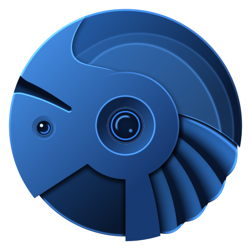
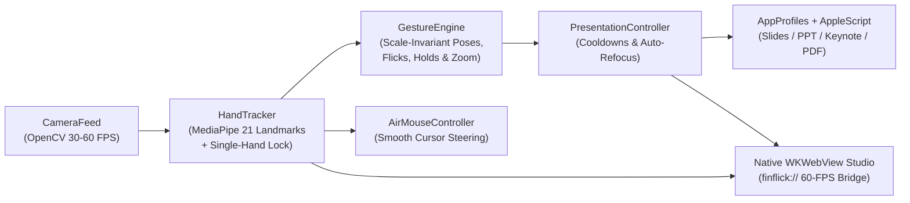

<p align="center">
  
</p>

<h1 align="center">🖐️ FinFlick — Touchless AI Presentation Assistant</h1>

<p align="center">
  <strong>Control your slides, embedded videos, zoom, and laser pointer from across the room using natural 3D hand gestures.</strong><br/>
  Built with Python, Google MediaPipe Hands, OpenCV, and a native macOS AppKit + GPU-accelerated WKWebView Studio HUD.
</p>

<p align="center">
  
  
  
  
  
</p>

---

## 📖 Overview

**FinFlick** turns any built-in webcam, USB camera, or wireless iPhone Continuity Camera into an intelligent, zero-contact presentation clicker. Designed specifically for **lecturers, educators, keynote speakers, and team presenters**, FinFlick tracks 21 3D hand landmarks at 30–60 FPS and translates deliberate gestures into native keyboard shortcuts and AppleScript commands for your active presentation app.

Unlike basic motion detectors, FinFlick uses a **scale-invariant geometric gesture engine** with **conversational hand-talk immunity**—so you can speak and gesture naturally with open hands without ever accidentally advancing a slide.

---

## ⚡ How It Works in 30 Seconds

1. **Launch FinFlick**: Run `./run.sh` in your terminal. The metallic-blue Studio window opens and automatically starts your webcam.
2. **Grant Accessibility Permission (First Launch Only)**: Click the permission pill in the top bar (or open **System Settings → Privacy & Security → Accessibility**) and enable your Terminal / IDE so FinFlick can send keystrokes to other apps.
3. **Click Your Presentation Window Once**: Open your deck in **PowerPoint, Keynote, Google Slides, Canva, Pitch, or PDF** and click it once. FinFlick automatically locks onto that app (and will even refocus it for you if you click back into FinFlick!).
4. **Present Hands-Free**: Point your index finger and flick right/left to navigate slides, show an OK sign (`👌`) to play/pause videos, or hold an L-shape (`👆`) to steer the on-screen Air-Mouse Laser Pointer.

---

## ✨ Key Features

- 🎯 **Universal Application Intelligence**: Automatically detects which presentation app is in the foreground and dispatches its exact native shortcuts or AppleScript commands:
  - **Google Slides** (in Chrome, Safari, Arc, Brave, Edge, Firefox, Orion, DuckDuckGo, Vivaldi, Zen)
  - **Microsoft PowerPoint** (Native macOS App & Office 365 Web)
  - **Apple Keynote**
  - **Canva** (Desktop & Web) & **Pitch**
  - **Adobe Acrobat / Reader** & **Apple Preview** (PDF Decks)
- 🔄 **Smart Auto-Refocus**: If you adjust a setting inside FinFlick and forget to click back onto your slides, FinFlick remembers your last active presentation window and brings it back to the front before firing your gesture command.
- 🛡️ **Conversational Gesture Immunity**: Multi-stage filtering ignores open-hand talking gestures, slow hand drifts, lowered resting hands, and reverse return strokes after a flick.
- 🤚 **Single-Hand Lock & Handedness Filter**: Locks onto the first active hand in frame and ignores secondary hands until the active hand leaves. Easily filter to **Left Hand Only**, **Both Hands**, or **Right Hand Only** from the top bar.
- 🔴 **Air-Mouse Laser Pointer**: Hold a 90° L-shape (thumb + index extended) to toggle native laser pointer mode and smoothly steer the macOS cursor across your slides with speed-adaptive tremor rejection.
- 🖥️ **60-FPS Metallic-Blue Studio HUD**:
  - **Laser Trajectory Trail & Targeting Reticle**: Visualizes fingertip velocity and armed state directly on the live camera feed.
  - **Hold-to-Trigger Charging Ring**: Real-time progress bar shows exact hold completion for deliberate gestures (`First Slide`, `Last Slide`, `Blackout`, `Pause`).
  - **3-Second Countdown Test Mode**: Click any gesture card in the right sidebar to trigger a 3-second countdown and test how your slide deck responds without performing the gesture.
  - **Built-In Lecture Stopwatch**: Start, pause, and reset your talk timer directly from the studio bar.
- 🔊 **Procedural Stereo Audio Feedback**: Synthesized low-latency metallic-glass audio cues confirm slide changes, zoom, and sleep/wake states without blocking.

---

## 🖐️ Complete Gestures Guide

All gesture distances are normalized to your **palm size** (wrist to middle knuckle), so FinFlick works identically whether you are **50 cm from your laptop** or **3 meters away on stage**.

### 1. Slide Navigation
| Gesture | Hand Pose & Motion | Action | Dispatched Shortcut |
| :--- | :--- | :--- | :--- |
| **Flick Right** ⏩ | Point with **Index Finger** (other fingers curled) and flick right | **Next Slide** | `Right Arrow` |
| **Flick Left** ⏪ | Point with **Index Finger** (other fingers curled) and flick left | **Previous Slide** | `Left Arrow` |
| **Index Finger Up** ☝️ | Hold **Index Finger pointing straight up** (others curled) for `1.0s` | **First Slide** | `Home` / Native AppleScript (PPT & Keynote) |
| **Thumbs Up** 👍 | Hold **Thumb pointing up** (all 4 fingers curled) for `1.0s` | **Last Slide** | `End` / Native AppleScript (PPT & Keynote) |

> 💡 **Tip:** Prefer phone-style swiping (flick left = Next Slide)? Toggle **Invert Swipe Direction** in the Studio settings tab!

### 2. Zoom & Media Control
| Gesture | Hand Pose & Motion | Action | Dispatched Shortcut |
| :--- | :--- | :--- | :--- |
| **Fist → Palm Bloom** ✊➡️🖐️ | Quickly burst open from **Closed Fist to Open Palm** (`<0.45s`) *or* spread **Thumb + Index** | **Zoom In (+15%)** | `Cmd + =` / PowerPoint `+` |
| **Thumbs Down** 👎 | Hold **Thumb pointing down** (4 fingers curled) for `0.4s` *(auto-repeats while held)* | **Zoom Out (-15%)** | `Cmd + -` / PowerPoint `-` |
| **OK Sign** 👌 | Touch **Thumb Tip to Index Tip** with Middle, Ring, and Pinky extended up | **Play / Pause Video** | `k` (Slides/Keynote) · `Ctrl+Opt+P` (PPT) · `Space` (Generic) |

### 3. Stage & Presentation Tools
| Gesture | Hand Pose & Motion | Action | Dispatched Shortcut |
| :--- | :--- | :--- | :--- |
| **Peace / V-Sign** ✌️ | Hold **Index + Middle fingers extended** (V-shape) for `0.8s` | **Start Presenting** | `Cmd+Return` (Slides/PPT/Pitch) · `Opt+Cmd+P` (Keynote/Canva) · `Cmd+L` (Acrobat) |
| **Laser Pointer (L-Shape)** 🔴 | Hold **Thumb + Index at 90° L-shape** (others curled) for `0.8s` | **Toggle Air-Mouse Laser** | `l` (Google Slides) · `Cmd+L` (PPT/Keynote) + Live Cursor Steering |
| **Closed Fist** ✊ | Hold a **stationary closed fist** at chest/shoulder height for `1.0s` | **Blackout Screen** | `b` (Google Slides / PowerPoint / Keynote) |
| **W-Sign (3 Fingers)** ⚪ | Hold **Index, Middle & Ring extended** (W-shape) for `0.8s` | **Whiteboard / White Screen** | `w` (Google Slides / PowerPoint / Keynote) |

### 4. Presenter Sleep / Wake Toggle
| Gesture | Hand Pose & Motion | Action | Behavior |
| :--- | :--- | :--- | :--- |
| **Open Palm** ✋ | Hold an **Open Palm** (all 5 fingers spread) facing the camera for `1.5s` | **Pause / Resume Tracking** | Puts FinFlick into **Sleep Mode** so you can gesticulate freely; hold an open palm again for `1.5s` to wake |

---

## 🖥️ Using the Desktop Studio UI

When you launch FinFlick, the native macOS Studio window provides real-time telemetry and one-click controls:

1. **Top Telemetry Bar**:
   - **Hand Filter Selector (`Left` / `Both` / `Right`)**: Choose which physical hand FinFlick should lock onto.
   - **Camera Switcher**: Cycle between your built-in FaceTime HD camera, external USB webcams, or iPhone Continuity Camera. (On launch, FinFlick automatically prioritizes your built-in Mac camera over Continuity Camera so your phone isn't unexpectedly woken up.)
   - **Target App Pill**: Shows which slide app is currently linked (e.g., `Target: Microsoft PowerPoint` or `Target: Google Chrome`). Click it anytime to immediately bring your slide deck to the foreground.
   - **Accessibility Status Pill**: Shows green (`ACCESSIBILITY OK`) when macOS keystroke injection is authorized, or amber (`GRANT ACCESS`) to open System Settings in one click.
   - **Lecture Timer**: Built-in stopwatch (`00:00`) with Play/Pause and Reset buttons to pace your talk.
2. **Center Live Viewport**:
   - Displays the 60-FPS camera feed with the 3D hand skeleton, pointing reticle, motion trail, and live status badge (`STANDBY`, `RIGHT LOCK`, `ARMED`, `CHARGING`, `COOLDOWN`, or `PAUSED`).
   - Includes quick-action overlays to **Pause/Resume Tracking** (`✋`) or toggle the **Laser Pointer** (`🔴`).
3. **Right Sidebar (`Gestures` & `Settings` Tabs)**:
   - **Quick Gestures Tab**: Interactive visual cards for all 12 gestures with live session counters. **Click any card** to start a **3-second countdown** that fires that command into your presentation window for easy testing.
   - **Settings & Calibration Tab**:
     - **One-Click Sensitivity Presets**: Switch between **Fast** (responsive short flicks), **Balanced** (default), and **Deliberate** (broad stage gestures).
     - **Custom Sliders**: Fine-tune *Swipe Distance (palms)*, *Swipe Speed (palms/s)*, and *Slide Cooldown (seconds)*.
     - **Toggle Switches**: Configure *Selfie Mirroring*, *Invert Swipe Direction*, *Auto-Refocus Slides*, *3D Hand Skeleton*, *Motion Trail*, *On-Video HUD Notifications*, and *Audio Feedback*.

---

## 🚀 Installation & Quick Start

### Prerequisites
- **macOS 12.0+** (Monterey, Ventura, Sonoma, Sequoia, or newer)
- **Python 3.10+**
- Built-in Mac webcam, external USB webcam, or iPhone Continuity Camera

### Option A: One-Command Launch (Recommended)
Clone the repository and run the included launcher script—it automatically creates a local `.venv` virtual environment, installs all dependencies, and starts FinFlick:

```bash
git clone https://github.com/courius/FinFlick.git
cd FinFlick
chmod +x run.sh
./run.sh
```

### Option B: Manual Virtual Environment Setup
```bash
git clone https://github.com/courius/FinFlick.git
cd FinFlick
python3 -m venv .venv
source .venv/bin/activate
pip install --upgrade pip
pip install -r requirements.txt
python main.py
```

### Granting macOS Permissions
FinFlick requires two standard macOS permissions:
1. **Camera Permission**: Prompted automatically on first launch so OpenCV can read frames from your webcam.
2. **Accessibility Permission**: Required by macOS so FinFlick can send synthetic keystrokes (`Right Arrow`, `Left Arrow`, `Cmd+Return`, etc.) and Air-Mouse movements to your presentation app.
   - Open **System Settings → Privacy & Security → Accessibility**.
   - Toggle ON your terminal or IDE application (**Terminal**, **iTerm2**, **VS Code**, **Cursor**, etc.).
   - Restart the app if macOS requires it after granting permission.

---

## ⚙️ Command-Line Options & Headless Mode

You can customize FinFlick at launch or run it completely headless in the background (`--headless`):

```bash
./run.sh [OPTIONS]
# or: .venv/bin/python main.py [OPTIONS]
```

| Flag | Description |
| :--- | :--- |
| `--camera INT` | Select camera index to use (default: `0`; use `--list-cameras` to inspect) |
| `--list-cameras` | List all detected camera devices and exit |
| `--track-hand {any,right,left}` | Lock tracking to a specific physical hand (`any`, `right`, or `left`) |
| `--cooldown FLOAT` | Minimum seconds between slide navigation actions (default: `0.70`) |
| `--no-sound` | Disable procedural stereo sound feedback |
| `--no-mirror` | Disable horizontal selfie camera mirroring |
| `--headless` | Run in background CLI daemon mode without opening the GUI window (`Ctrl+C` to stop) |
| `--reset-settings` | Ignore saved user settings in `~/Library/Application Support/FinFlick/config.json` and use defaults |
| `--debug` | Enable verbose debug logging in the terminal |

---

## 🏗️ Project Architecture

```text
FinFlick/
├── main.py                      # CLI entrypoint, permission checks, and app lifecycle
├── run.sh                       # One-command virtualenv setup & launcher script
├── requirements.txt             # Python & macOS PyObjC dependencies
├── core/
│   ├── camera.py                # Threaded OpenCV capture & Continuity Camera detection
│   ├── hand_tracker.py          # MediaPipe HandLandmarker wrapper, single-hand lock & HUD rendering
│   ├── gesture_engine.py        # Scale-invariant pose classifier & swipe/hold/zoom state machine
│   ├── controller.py            # Cooldown manager, auto-refocus, & keystroke/AppleScript dispatcher
│   ├── air_mouse.py             # 3D fingertip-to-screen cursor mapper with tremor rejection
│   ├── app_profiles.py          # Foreground app detector & per-app shortcut profiles
│   ├── pipeline.py              # Real-time capture → tracking → gesture → HUD frame pipeline
│   └── config.py                # Persistent JSON configuration dataclass
├── ui/
│   ├── app_window.py            # Native macOS AppKit NSWindow + WKWebView finflick:// host
│   ├── web_assets.py            # Self-contained HTML5/CSS3/SVG Studio UI & vector icons
│   ├── logo.py                  # Procedural metallic-blue icon & SVG generator
│   ├── splash.py                # Animated aperture iris startup sequence
│   └── theme.py                 # Color palette & design tokens
├── utils/
│   ├── macos_permissions.py     # macOS Accessibility & Camera permission helpers + App Nap blocker
│   ├── apple_script_bridge.py   # Direct AppleScript control for PowerPoint & Keynote slideshows
│   └── sound_feedback.py        # Procedural stereo WAV synthesizer & non-blocking audio player
├── models/
│   └── hand_landmarker.task     # Google MediaPipe float16 hand landmarker model (auto-downloaded if missing)
├── assets/                      # App icons, SVG vectors, and synthesized stereo audio cues
└── tests/                       # 93 unit tests covering gestures, hand locking, profiles, air mouse & UI
```



---

## 🧪 Running Automated Tests

FinFlick includes a comprehensive **93-test suite** covering geometric pose classification, flick velocity math, return-stroke immunity, single-hand locking, air-mouse smoothing, application shortcut profiles, and the `WKWebView` RPC bridge:

```bash
.venv/bin/python -m unittest discover -s tests -v
```

---

## ❓ Troubleshooting & FAQ

<details>
<summary><strong>Gestures are detected in FinFlick, but my slides aren't moving</strong></summary>

1. Check the **Accessibility Pill** in the top-right corner of FinFlick. If it says `GRANT ACCESS`, click it and enable your Terminal / IDE inside **System Settings → Privacy & Security → Accessibility**.
2. If you just enabled Accessibility permission, **quit and restart your Terminal/IDE** so macOS applies the new security token.
3. Click your presentation window once so FinFlick knows which window is your target slide deck.
</details>

<details>
<summary><strong>FinFlick opened my iPhone Continuity Camera instead of my MacBook webcam</strong></summary>

FinFlick automatically detects Continuity Cameras on launch and prioritizes your built-in Mac camera. If you ever want to switch cameras manually, click the **Camera Selector** button in the top bar of the Studio UI or launch with `./run.sh --list-cameras` and `./run.sh --camera <INDEX>`.
</details>

<details>
<summary><strong>How far away from the camera can I stand?</strong></summary>

Because FinFlick measures all movement distances in **palm lengths** rather than raw pixels, you can sit right at your desk (`~50 cm`) or stand across a podium/classroom (`2–3 meters` away). For long-distance stage use, try selecting the **Fast** sensitivity preset in the **Settings** tab.
</details>

---

## 📄 License

Distributed under the **MIT License**. See [`LICENSE`](LICENSE) for full details.
